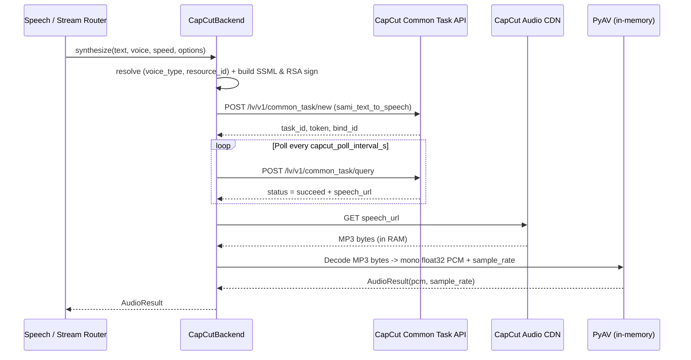

# Phase 1: Backend Adapter & Catalog (vi-VN)

## Overview

Trích xuất 24 giọng Tiếng Việt (`vi-VN`) từ `phan_tich/capcut-tts-api/capcut_tts_api/Voice.json` sang `app/data/capcut_voices.json`, viết adapter tự chủ `app/backends/capcut_backend.py` (`CapCutBackend`), bổ sung cấu hình vào `app/config.py` và đăng ký vào `app/main.py`.

## Requirements

- [x] Chỉ trích xuất đúng 24 giọng `vi-VN` (`catalog_kind != "digital_human_voice"`) vào `app/data/capcut_voices.json`.
- [x] `CapCutBackend` (`name = "capcut"`, `supports_cloning = False`) kế thừa `VoiceBackend`, tự chủ hoàn toàn phần ký request (`make_sign_header`, `make_tts_payload_sign` RSA PKCS#1 v1.5) và gọi HTTP (dùng `urllib.request` hoặc `httpx` / `requests` sẵn có, không phụ thuộc thư mục `phan_tich/`).
- [x] Giải mã bytes MP3 tải từ CapCut CDN trực tiếp trong bộ nhớ (`io.BytesIO` + `av.open`) sang mono `np.float32` PCM (`[-1.0, 1.0]`) + `sample_rate` để trả về `AudioResult`.
- [x] Bổ sung cài đặt `enable_capcut`, `capcut_voices_path`, `capcut_default_voice`, `capcut_base_url`, `capcut_timeout_s`, `capcut_poll_interval_s` trong `app/config.py`.
- [x] Đăng ký `CapCutBackend` có guard `is_available(settings)` trong `app/main.py::_register_backends()`.

## Architecture



## Related Code Files

- Create: `app/data/capcut_voices.json`
- Create: `app/backends/capcut_backend.py`
- Modify: `app/config.py`
- Modify: `app/main.py`

## Implementation Steps

1. **Tạo `app/data/capcut_voices.json`**:
   - Lọc 24 bản ghi có `lang == "vi-VN"` (và `catalog_kind != "digital_human_voice"`) từ `phan_tich/capcut-tts-api/capcut_tts_api/Voice.json`.
   - Giữ các trường sạch: `voice_type`, `display_name`, `resource_id`, `lang` (`"vi-VN"`), `lan` (`"vi"`).
2. **Cập nhật `app/config.py`**:
   - Thêm nhóm cấu hình CapCut vào `Settings`:
     ```python
     # --- CapCut (Vietnamese cloud preset TTS) ---
     enable_capcut: bool = True
     capcut_voices_path: str = "app/data/capcut_voices.json"
     capcut_default_voice: str = "BV421_vivn_streaming"
     capcut_base_url: str = "https://editor-api-sg.capcutapi.com"
     capcut_timeout_s: float = 60.0
     capcut_poll_interval_s: float = 1.0
     capcut_cookie: str = ""
     capcut_bearer: str = ""
     ```
3. **Viết `app/backends/capcut_backend.py`**:
   - Port các hàm ký thuần Python từ `signer.py` (`compact_json`, `make_x_ss_stub`, `make_trace_id`, `escape_xml`, `rsa_public_numbers_from_pem`, `rsa_encrypt_pkcs1v15`, `make_tts_payload_sign`, `make_sign_header`, `common_query`, `base_headers`).
   - Cài đặt hàm `_decode_mp3_bytes(audio_bytes: bytes) -> tuple[np.ndarray, int]` dùng `av.open(io.BytesIO(audio_bytes))` giải mã từng `AudioFrame`, chuyển về mono `np.float32` trong khoảng `[-1.0, 1.0]`.
   - Cài đặt `CapCutBackend(VoiceBackend)`:
     - `name = "capcut"`, `supports_cloning = False`.
     - `is_available(settings)`: kiểm tra `os.path.isfile(settings.capcut_voices_path)` và có ít nhất 1 giọng hợp lệ.
     - `list_voices()`: đọc `capcut_voices.json`, trả về danh sách `Voice(id=item["voice_type"], name=item["display_name"], model="capcut", language="vi")`.
     - `resolve_voice(voice, *, strict=False)`: khớp `id` (`voice_type`, không phân biệt hoa thường) hoặc `name` (`display_name`); nếu `not strict` thì fallback về `settings.capcut_default_voice` (`BV421_vivn_streaming`).
     - `synthesize(text, voice, speed=1.0, options=None)`: tạo SSML (với `<prosody rate="{speed:.2f}">`), gửi task `/lv/v1/common_task/new`, poll `/lv/v1/common_task/query`, tải MP3 từ `speech_url`/`audio_url`/`url` và gọi `_decode_mp3_bytes()` trả về `AudioResult`. Không giữ global lock giữa các request khác nhau (hoặc chỉ đồng bộ hóa nhẹ) vì đây là I/O mạng và concurrency đã được kiểm soát bởi `admit()` (`synth_semaphore`).
4. **Đăng ký trong `app/main.py`**:
   - Trong `_register_backends()`, thêm nhánh `if settings.enable_capcut:` tương tự `kokoro` và `voicevox`, log rõ ràng nếu thiếu file catalog, và cập nhật `API_DESCRIPTION`.

## Todo

- [x] Tạo `app/data/capcut_voices.json` với 24 giọng `vi-VN`
- [x] Thêm cấu hình CapCut vào `app/config.py`
- [x] Hiện thực `app/backends/capcut_backend.py` kèm giải mã PyAV in-memory
- [x] Đăng ký `CapCutBackend` trong `app/main.py`

## Success Criteria

- [x] `CapCutBackend.is_available(get_settings())` trả về `True`.
- [x] `CapCutBackend(get_settings()).list_voices()` trả về đúng 24 đối tượng `Voice` với `model="capcut"` và `language="vi"`.
- [x] Giải mã MP3 bằng `_decode_mp3_bytes` trả về mảng `np.float32` 1 chiều hợp lệ và `sample_rate > 0`.

## Risk Assessment

- **CapCut API trả lỗi ứng dụng (`ret != 0`, vd `ret=1014` system busy) với HTTP 200**: Kiểm tra trường `ret` ngay trong `_checked_json_response` giống bản gốc và raise `RuntimeError` rõ ràng; router `speech.py` sẽ tự động hoàn trả (`refund_chars`) quota cho người dùng ANON.
- **Giọng có trùng `display_name`**: `resolve_voice` ưu tiên khớp `voice.id` (`voice_type` là duy nhất cho cả 24 giọng) trước khi khớp `voice.name`.
